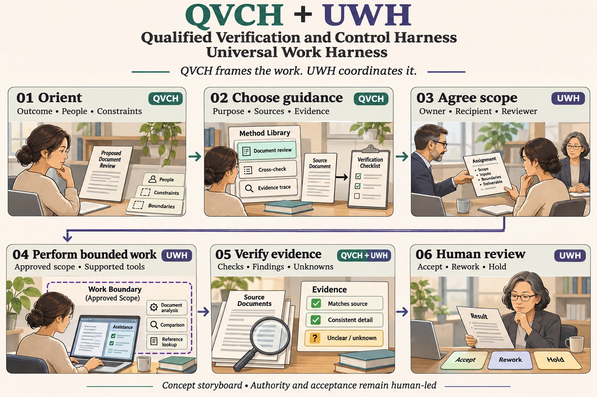
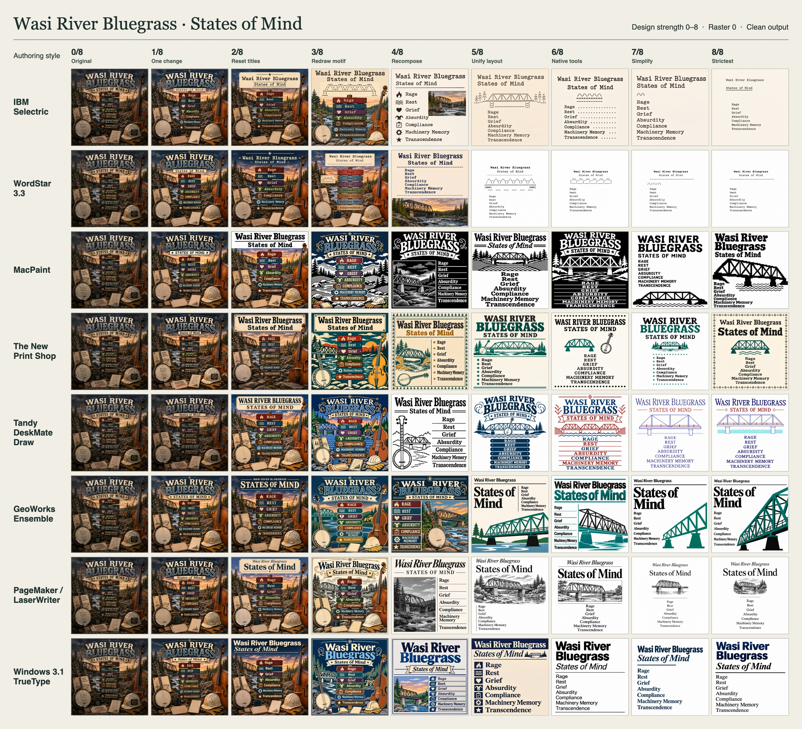

# Skills for engineering and advisory work

Reusable methods for psychologically safe, evidence-informed and risk-managed use of AI in professional engineering and advisory work. The repository is organized around two central components: **Qualified Verification and Control Harness (QVCH)** and **Universal Work Harness (UWH)**. Supporting skills provide the specialist methods they bring into a task.

## Core architecture

| Component | Role | Start here |
| --- | --- | --- |
| **Qualified Verification and Control Harness (QVCH)** | Frame the intended outcome, select an engineering purpose, choose relevant guidance and identify the authority and evidence needed for the work. | [QVCH skill](qvch/SKILL.md) |
| **Universal Work Harness (UWH)** | Coordinate scoped work across people and agents: intake, assignment, recipient response, supported execution, evidence and review. | [UWH skill](unified-work-harness/SKILL.md) |

*From purpose to reviewed work.* [Read the six-step transcript and source notes](docs/qvch-uwh/README.md). The storyboard illustrates the workflow; its people, checks and decision cards are examples.

### QVCH: purpose, guidance and verification

QVCH starts with orientation (`0x0`), then selects one primary purpose (`0x1–0xF`), such as design, investigate, build or verify. Companion lenses and project-specific routing can bring in additional methods when they help. Routine work can use this lightweight process directly.

“Qualified” means that claims about readiness and verification depend on the evidence and limits established for the particular source revision, host and intended use. Selecting a mode does not itself qualify a tool or grant permission. Control means keeping scope, permitted effects, concerns and review decisions explicit; the name does not imply certification or autonomous operational control.

### UWH: scoped coordination and execution

UWH carries that purpose into a bounded assignment with an accountable owner, a recipient, defined workspace and permissions, acceptance criteria, evidence and a reviewer. It supports human, agent and hybrid work. The packaged interfaces include reviewed intake, attended coordination, read-only agent work, sequential queues and separately scoped candidate changes; the [capability crosswalk](unified-work-harness/capabilities.md) identifies supported entry points and their limits.

UWH remains the top-level coordinator for work using its contracts. QVCH supplies purpose and guidance within that coordination; specialist skills and host adapters contribute methods and capabilities. Actual authority comes from the user and governing host/project rules. Recipient acceptance, execution evidence and human review remain separate decisions. “Universal” describes the common coordination model across kinds of work; each host and adapter still needs its own supported capabilities and operating bounds.

## Using the skills together

1. **Orient with QVCH.** Define the outcome, affected people and systems, relevant constraints and primary purpose. Select the methods that fit.
2. **Use UWH for a scoped assignment or handoff.** Establish ownership, authority, capacity, workspace, evidence and review before invoking the selected execution path.
3. **Review the result against the intended use.** Preserve findings and unresolved concerns, and record the human disposition separately from automated checks.

The [skills and work contract interface](docs/work-contract-interface.md) explains how methods, boundaries and responses fit together. Supporting guidance covers [engineering work and safety](engineering-work-safety/SKILL.md), [call and response](call-and-response-harness/SKILL.md), [bounded delegation](harnessed-dispatch/SKILL.md) and [AI-enabled engineering](forward-deployed-ai-engineer/SKILL.md). The [system description](unified-work-harness/engineered-system.md) provides a deeper architectural baseline.

## Installation and compatibility

The names above are the current expansions. Existing installation identifiers remain `qvch` and `unified-work-harness`; directory names, commands and contract/schema identifiers retain compatibility. Dated records and illustrations may use the former names.

For the previously accepted release, [PR #24](https://github.com/chrisjones77/skills/pull/24) landed at [`f8195f6`](https://github.com/chrisjones77/skills/commit/f8195f6d7606edce9ccebaa334a10b8a5132c3d2). Copy the complete `unified-work-harness/` directory from that commit into the host's skill directory, then run `node package.mjs inventory` and compare `sourceSha256` with the [acceptance record](docs/unified-work-harness-tests.md#accepted-release). The current source includes later changes, including this terminology update; its package digest is not the historical release digest. Review and pin the revision you actually select.

The package needs Node 22.13 or later on POSIX. Run `node examples/attended-review.mjs` from the selected package for an offline walkthrough. Optional Codex and Claude reviewer roles are enabled separately in each project. Follow the [installation and role guide](unified-work-harness/package-guide.md).

## Workflow storyboards

[Browse the individual skill storyboards](docs/skill-storyboards/README.md), with text transcripts, canonical source links and generation provenance. The images are concept illustrations; the skills remain authoritative.

[Work and safety record](specs/001-skill-storyboards/work-and-safety.md): scope and authority, execution evidence, image corrections, review responsibilities, concern response and remaining limitations.

## Independent work recorder

The [Git-first recorder and read-only bus monitor](work-recorder/README.md) provide a standalone event contract, QVCH/UWH observation adapters, synthetic examples and replay. Recording evidence remains distinct from accepting work or authorizing execution.

## Retro desktop publishing

Retro-DTP 0.5.1 composes editable print documents and redesigns images using eight period toolsets, from the IBM Selectric to PostScript and early TrueType. Design strength controls how much of the composition to rebuild. Raster strength and simulated printer marks can be selected separately. [Skill and presets](retro-dtp/SKILL.md) · [Print setup](retro-dtp/references/production.md)

For ChatGPT Images, download the design card and attach it with the original image. Try “Redesign this for The New Print Shop for DOS at design 6/8. Keep the title exact, raster 0, clean output.” The optional raster attachment runs with Python and Pillow. [Design card](docs/retro-dtp/retro-design-filter.txt) · [Raster attachment](docs/retro-dtp/retro-filter.txt)

The *States of Mind* grid shows the same Wasi River Bluegrass cover across eight styles and nine design settings. Open the gallery to see any cover at full size. [Complete *States of Mind* grid](docs/retro-dtp/states-of-mind/grid/) · [Raster continuum at design 8/8](docs/retro-dtp/states-of-mind/raster-grid/) · [Compare printer finishes](docs/retro-dtp/states-of-mind/printer-grid/) · [Standalone skill README](retro-dtp/README.md)
