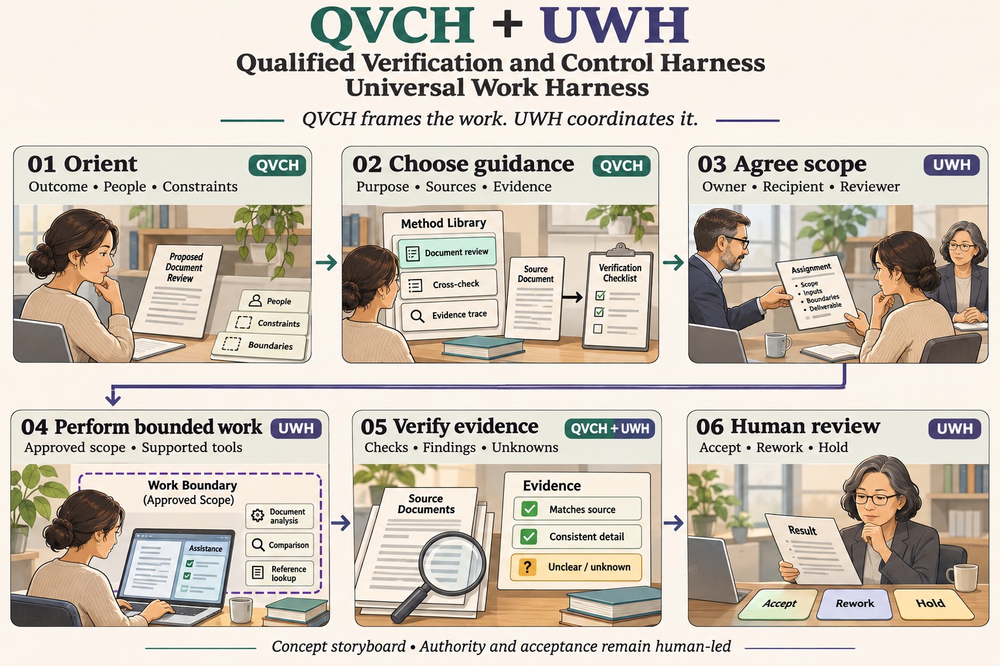

# QVCH and UWH: from purpose to reviewed work

**Qualified Verification and Control Harness (QVCH)** frames purpose, relevant guidance and the evidence needed to assess a task. **Universal Work Harness (UWH)** coordinates scoped work across people and agents, including recipient responses, supported execution and review. Together they connect the intended outcome to a result that a person can assess.

This is a concept storyboard of an attended document review. The people, workspace, checklist marks and decision cards are illustrative. They do not record a real assignment, successful verification or owner acceptance. Open the image for full-size labels; the transcript below conveys the workflow without relying on the image.

## Storyboard transcript

| Step | Depicted action | Meaning for the workflow |
| --- | --- | --- |
| **01 Orient — QVCH** | A person reviews the proposed outcome alongside people, constraints and boundaries. | Identify what the task is for, who is affected and what limits matter. |
| **02 Choose guidance — QVCH** | Method cards, a source document and a verification checklist are brought together. | Select a primary purpose and relevant methods; establish which sources and evidence the task needs. Checklist marks are examples, not validation results. |
| **03 Agree scope — UWH** | An owner offers an assignment to a recipient with a reviewer present. | Define outcome, scope, inputs, boundaries and deliverable. The recipient must respond; an offer alone is not acceptance or authority to execute. |
| **04 Perform bounded work — UWH** | A person uses software assistance to analyze, compare and look up references inside the depicted work boundary. | Apply the supported tools within the actual authorized scope. The drawn boundary describes scope; it is not proof of sandbox enforcement. |
| **05 Verify evidence — QVCH + UWH** | Source documents are compared with evidence cards, including an unresolved question. | Check results against their sources and criteria. Preserve unknowns and findings rather than turning a byte match or populated checklist into a correctness claim. |
| **06 Human review — UWH** | A reviewer reads the result and considers Accept, Rework and Hold. | Record a human disposition about the exact work. No option is automatically selected, and further effects require their own authority. |

The image reads left to right across the top row, then continues at the lower left. A changed outcome or scope calls for renewed review and an appropriate recipient response. Routine tasks can use QVCH directly; formal assignments and handoffs use UWH coordination. Specialist skills contribute methods under these boundaries.

## Source and naming notes

- [QVCH skill](../../qvch/SKILL.md): orientation, purpose modes, source selection and authority boundaries.
- [UWH skill](../../unified-work-harness/SKILL.md): coordination, supported contracts, execution and review.
- [Capability crosswalk](../../unified-work-harness/capabilities.md): supported entry points and limits.
- [Skills and work contract interface](../work-contract-interface.md): recipient disposition, continuity, evidence and substantive review.

This overview uses the current expansions requested on 20 November 2026. Installation identifiers remain `qvch` and `unified-work-harness`. The [earlier individual-skill gallery](../skill-storyboards/README.md) remains available with its historical illustrations. This combined architectural overview is separate from that gallery's one-board-per-skill inventory.

## Generation and review record

Generated with the built-in image-generation tool on 20 November 2026. The selected image is 1536 × 1024 pixels and is stored in this repository. [Generation record and exact prompt](generation.json) · [Source identities](sources.json) · [Image coverage record](coverage.json) · [Coverage validation](coverage-report.json).

The assistant inspected the generated image's six panels, reading order, names, headings, uncertainty marker and human decision options. The full-size headings and captions are legible. Smaller in-scene text is illustrative; full-size viewing and the transcript support readers when the README image is reduced. Phone browser rendering has not been separately verified.

The coverage tool checks record completeness and the asset's byte identity; it does not inspect pixels or prove the workflow. The owner subsequently approved publishing this selected image and documentation with “ship it”; see the [exact scope and asset binding](owner-acceptance.md). The [earlier assistant record](coverage-assistant.json) remains separate. This acceptance does not qualify an operational workflow or change installed packages. Publication and merge results are recorded in the pull request.
