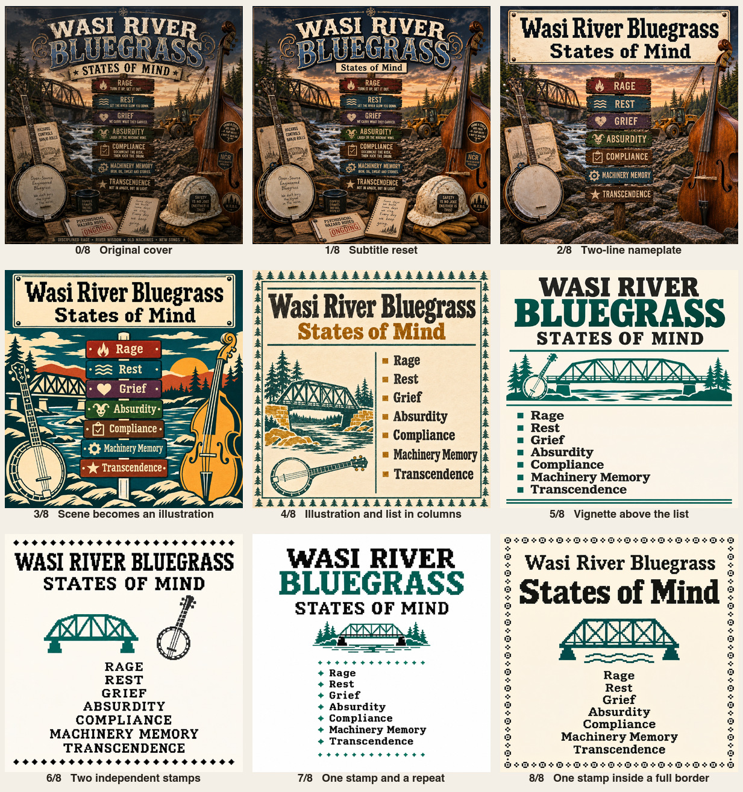

# States of Mind · nine Print Shop design settings

[Browse all eight styles at every design strength](grid/) · [Raster continuum at design 8/8](raster-grid/) · [Compare printer finishes](printer-grid/)

Read left to right, top to bottom. Level 0 is the original Wasi River Bluegrass cover. Levels 1–8 reinterpret it with the lettering, stamps and repeated borders of The New Print Shop for DOS. Every version keeps the band name, album title, seven state names and bridge. Raster strength stays at 0 and the printer finish stays clean throughout.

| Design strength | What changes on this cover |
| --- | --- |
| [0 · Original](level-0.jpeg) | Seven wooden signs rise from a river scene with instruments and worksite props. |
| [1 · Subtitle](level-1.png) | The album title moves from a curved banner to a straight strip. The band lettering and scene retain their original arrangement. |
| [2 · Nameplate](level-2.png) | The band name joins the album title on a flat, two-line nameplate. The landscape below still has depth. |
| [3 · Illustration](level-3.png) | The landscape becomes a flat, limited-colour drawing. Each state name still sits on a sign within the scene. |
| [4 · Columns](level-4.png) | The names leave the scene and form a list on the right. The bridge and banjo occupy the left column. |
| [5 · Vignette](level-5.png) | The bridge and banjo share one horizontal illustration above a left-aligned list. |
| [6 · Two stamps](level-6.png) | The bridge and banjo stand apart as two stamps. The names form a centred column below. |
| [7 · One stamp](level-7.png) | A small bridge with pines is the sole picture. Repeated diamonds organize the left-aligned names. |
| [8 · Stamp and border](level-8.png) | Two title lines, one bridge stamp, seven centred names and a repeating border carry the whole cover. |

Select any level to see the full-size cover. To use the slider offline, download the repository and open this folder’s `index.html` in a browser. “Compare with original” returns to level 0 while remembering your selected setting. [Design brief](brief.txt) · [Image hashes and review](review.json)

To hold the strength at 8/8 and change the toolset instead, [compare all eight styles side by side](eight-styles/).
