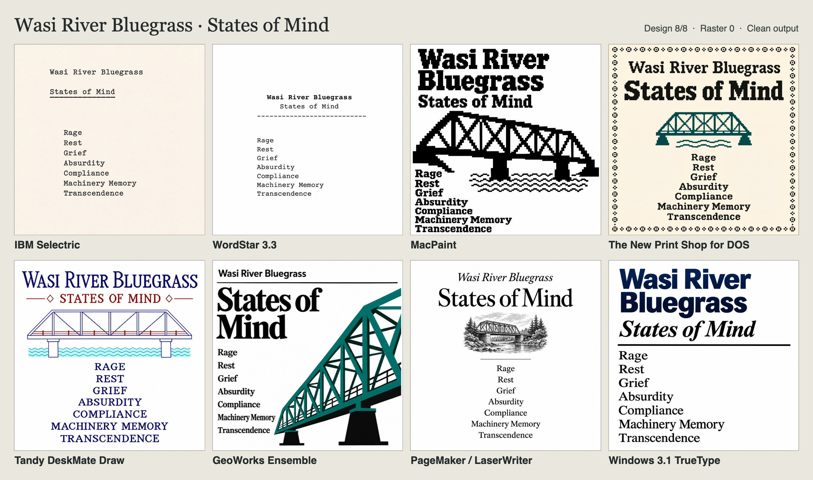

# States of Mind · eight styles at design 8/8

[Browse all eight styles at every design strength](../grid/)

Each cover starts with the same Wasi River Bluegrass artwork and the same nine pieces of copy: the band name, the album title and the seven state names in order. At 8/8, the chosen toolset determines how to build the whole page. Raster strength is 0, with a clean finish throughout.

| Full-size cover | What to look for |
| --- | --- |
| [IBM Selectric](selectric.png) | A single type element, an underlined title and a tabbed list give the sheet its hierarchy. |
| [WordStar 3.3](wordstar.png) | A centred heading, printer emphasis and a typed hyphen rule organize the list within a fixed character measure. |
| [MacPaint](macpaint.png) | The heavy black silhouette, stepped letters and repeating waves share one bitmap-style picture plane. |
| [The New Print Shop for DOS](../level-8.png) | Two bitmap title lines, a small bridge stamp and a repeating border leave room for seven centred names. |
| [Tandy DeskMate Draw](deskmate.png) | Thin polylines form the truss, rectangles make the piers and a patterned cyan strip suggests water. |
| [GeoWorks Ensemble](geoworks.png) | The diagonal teal bridge sits beside a narrow text column. Its scale and placement give the page its asymmetry. |
| [PageMaker / LaserWriter PostScript](pagemaker.png) | A small monochrome engraving sits between the large roman title and a fine rule, like a placed illustration on a book title page. |
| [Windows 3.1 TrueType](windows-truetype.png) | A large navy sans-serif band name, an italic album title and a single rule carry the cover without a picture. |

These are image-generator interpretations of the eight Retro-DTP presets. The Selectric and Print Shop covers are the previously reviewed 8/8 images. The six other covers were generated from the same original for this comparison. [Original cover](../level-0.jpeg) · [All nine Print Shop design strengths](../) · [Prompts and image hashes](generation.json)
