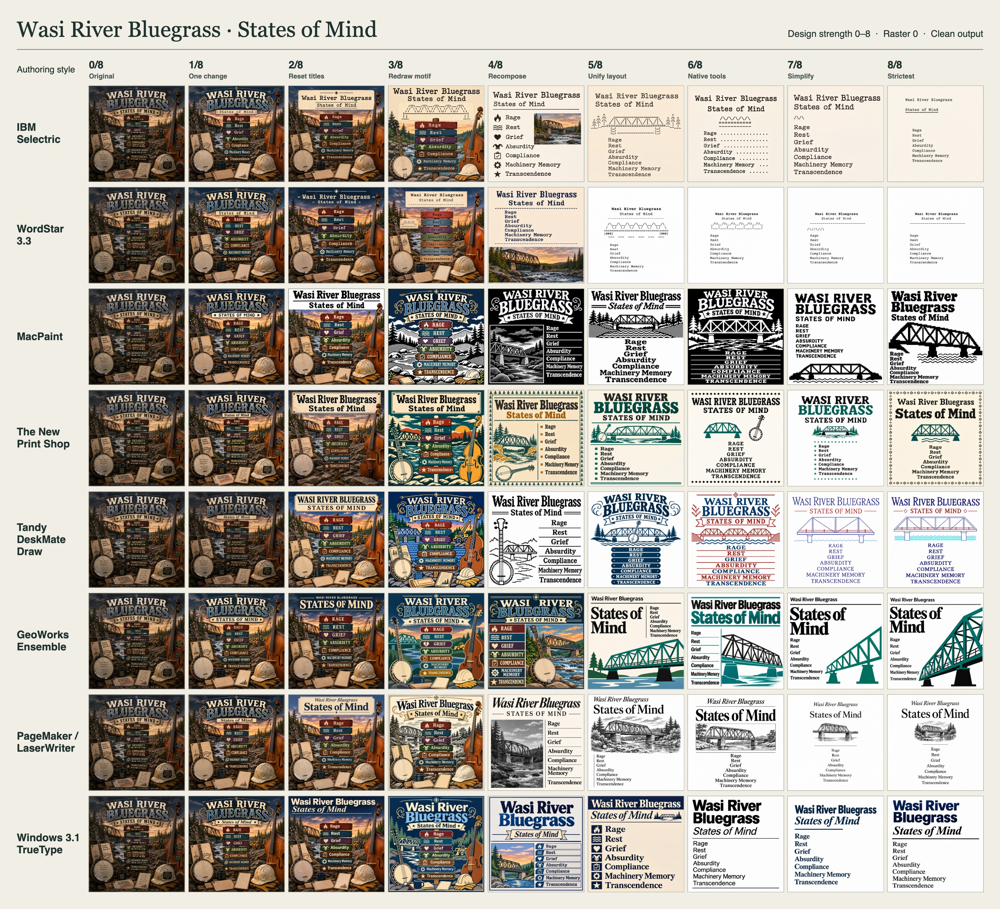

# States of Mind · the complete Retro-DTP design grid

Read across a row to see how one toolset changes the cover. Read down a column to compare what eight toolsets do with the same design strength. Every row begins with the same Wasi River Bluegrass catalogue cover. Raster strength stays at **0** and the printer finish stays **clean** in all 72 cells. [Compare all nine raster strengths at design 8/8](../raster-grid/)

## Open a full-size cover

Choose a style name for a three-by-three sheet of its nine settings, or select a number to open one cover.

| Style | 0 | 1 | 2 | 3 | 4 | 5 | 6 | 7 | 8 |
| --- | --- | --- | --- | --- | --- | --- | --- | --- | --- |
| [IBM Selectric](selectric/nine-settings.jpg) | [0](../level-0.jpeg) | [1](selectric/1.webp) | [2](selectric/2.webp) | [3](selectric/3.webp) | [4](selectric/4.webp) | [5](selectric/5.webp) | [6](selectric/6.webp) | [7](selectric/7.webp) | [8](../eight-styles/selectric.png) |
| [WordStar 3.3](wordstar/nine-settings.jpg) | [0](../level-0.jpeg) | [1](wordstar/1.webp) | [2](wordstar/2.webp) | [3](wordstar/3.webp) | [4](wordstar/4.webp) | [5](wordstar/5.webp) | [6](wordstar/6.webp) | [7](wordstar/7.webp) | [8](../eight-styles/wordstar.png) |
| [MacPaint](macpaint/nine-settings.jpg) | [0](../level-0.jpeg) | [1](macpaint/1.webp) | [2](macpaint/2.webp) | [3](macpaint/3.webp) | [4](macpaint/4.webp) | [5](macpaint/5.webp) | [6](macpaint/6.webp) | [7](macpaint/7.webp) | [8](../eight-styles/macpaint.png) |
| [The New Print Shop for DOS](../all-nine.jpg) | [0](../level-0.jpeg) | [1](../level-1.png) | [2](../level-2.png) | [3](../level-3.png) | [4](../level-4.png) | [5](../level-5.png) | [6](../level-6.png) | [7](../level-7.png) | [8](../level-8.png) |
| [Tandy DeskMate Draw](deskmate/nine-settings.jpg) | [0](../level-0.jpeg) | [1](deskmate/1.webp) | [2](deskmate/2.webp) | [3](deskmate/3.webp) | [4](deskmate/4.webp) | [5](deskmate/5.webp) | [6](deskmate/6.webp) | [7](deskmate/7.webp) | [8](../eight-styles/deskmate.png) |
| [GeoWorks Ensemble](geoworks/nine-settings.jpg) | [0](../level-0.jpeg) | [1](geoworks/1.webp) | [2](geoworks/2.webp) | [3](geoworks/3.webp) | [4](geoworks/4.webp) | [5](geoworks/5.webp) | [6](geoworks/6.webp) | [7](geoworks/7.webp) | [8](../eight-styles/geoworks.png) |
| [PageMaker / LaserWriter PostScript](pagemaker/nine-settings.jpg) | [0](../level-0.jpeg) | [1](pagemaker/1.webp) | [2](pagemaker/2.webp) | [3](pagemaker/3.webp) | [4](pagemaker/4.webp) | [5](pagemaker/5.webp) | [6](pagemaker/6.webp) | [7](pagemaker/7.webp) | [8](../eight-styles/pagemaker.png) |
| [Windows 3.1 TrueType](windows-truetype/nine-settings.jpg) | [0](../level-0.jpeg) | [1](windows-truetype/1.webp) | [2](windows-truetype/2.webp) | [3](windows-truetype/3.webp) | [4](windows-truetype/4.webp) | [5](windows-truetype/5.webp) | [6](windows-truetype/6.webp) | [7](windows-truetype/7.webp) | [8](../eight-styles/windows-truetype.png) |

For a keyboard-accessible comparison offline, download the repository and open this folder’s `index.html`. Select the style, then move the strength slider. Changing styles keeps the same strength.

At 1 the brief changes one lettering or placement choice. At 3 it asks for the main motif to be redrawn. At 4 it recomposes the page. At 6 the whole design must fit the selected tools, then 7 and 8 progressively reduce the number of marks or objects. The specific compositions are examples of those instructions. Generative details can vary even at low strength.

All versions carry the artist, album title and seven state names. Incidental signs and slogans may disappear as the layout changes. The shared original, the existing Print Shop row and the eight previously reviewed endpoints are reused here. The other 49 images were individually composed from the original reference. [Source brief](../brief.txt) · [Prompts and image hashes](generation.json) · [Standalone Retro-DTP guide](../../../../retro-dtp/README.md)
