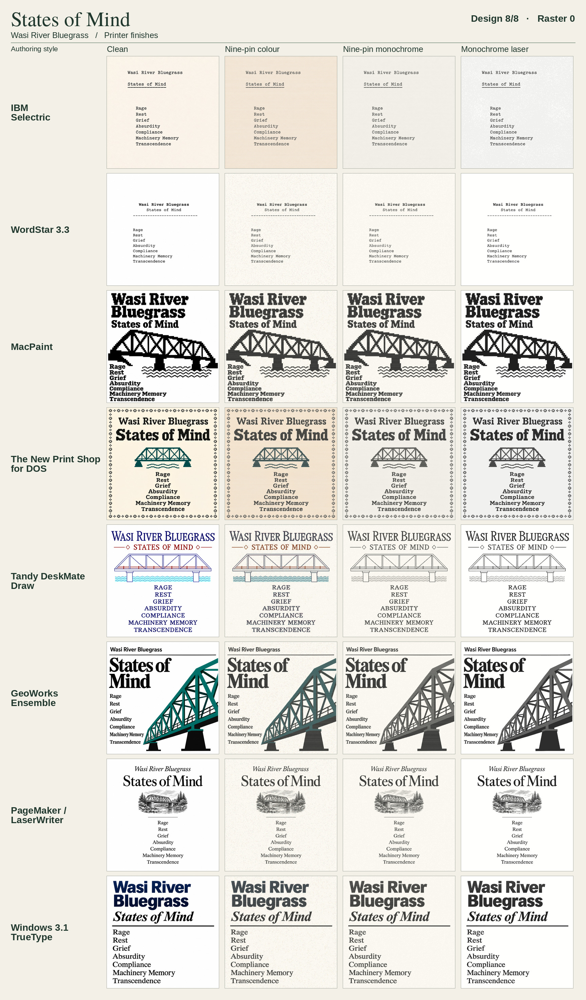
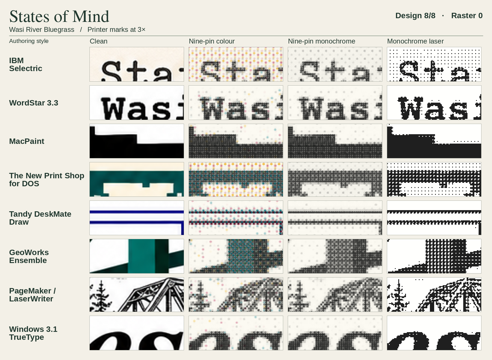

# States of Mind · printer finishes

Read across each row to see the same Wasi River Bluegrass cover through four printer finishes. All eight styles use their published **design 8/8** composition at **raster 0**. The clean column opens the full-size master used for the other three proofs. [Design grid](../grid/) · [Raster grid](../raster-grid/)

## Compare the marks

- **Clean** shows the original cover pixels, including any paper tone or lettering texture already present in the design.
- **Nine-pin colour** uses separate cyan, magenta, yellow and black ribbon passes. Look at the coloured edge of the Print Shop truss for the slight offsets between strikes.
- **Nine-pin monochrome** uses one black ribbon on the same warm paper, with the same pin spacing and nine-row sweeps. The DeskMate lines show how the source colours translate into different ink densities.
- **Monochrome laser** uses a simulated 300 dpi toner grid with a clustered 75-line-per-inch halftone. Look at the fine marks around the PageMaker bridge for how the screen carries gray tones.

These are illustrative print simulations. The laser proof assumes a 4.18-inch-wide print of the 1254-pixel master. The printer model determines the marks on paper, while the skill’s separate raster filter stays at 0.

## Open a full-size cover

| Style | Clean | Nine-pin colour | Nine-pin monochrome | Monochrome laser |
| --- | --- | --- | --- | --- |
| IBM Selectric | [Clean](../eight-styles/selectric.png) | [Nine-pin colour](nine-pin-colour/selectric.png) | [Nine-pin monochrome](nine-pin-monochrome/selectric.png) | [Monochrome laser](monochrome-laser/selectric.png) |
| WordStar 3.3 | [Clean](../eight-styles/wordstar.png) | [Nine-pin colour](nine-pin-colour/wordstar.png) | [Nine-pin monochrome](nine-pin-monochrome/wordstar.png) | [Monochrome laser](monochrome-laser/wordstar.png) |
| MacPaint | [Clean](../eight-styles/macpaint.png) | [Nine-pin colour](nine-pin-colour/macpaint.png) | [Nine-pin monochrome](nine-pin-monochrome/macpaint.png) | [Monochrome laser](monochrome-laser/macpaint.png) |
| The New Print Shop for DOS | [Clean](../level-8.png) | [Nine-pin colour](nine-pin-colour/print-shop.png) | [Nine-pin monochrome](nine-pin-monochrome/print-shop.png) | [Monochrome laser](monochrome-laser/print-shop.png) |
| Tandy DeskMate Draw | [Clean](../eight-styles/deskmate.png) | [Nine-pin colour](nine-pin-colour/deskmate.png) | [Nine-pin monochrome](nine-pin-monochrome/deskmate.png) | [Monochrome laser](monochrome-laser/deskmate.png) |
| GeoWorks Ensemble | [Clean](../eight-styles/geoworks.png) | [Nine-pin colour](nine-pin-colour/geoworks.png) | [Nine-pin monochrome](nine-pin-monochrome/geoworks.png) | [Monochrome laser](monochrome-laser/geoworks.png) |
| PageMaker / LaserWriter PostScript | [Clean](../eight-styles/pagemaker.png) | [Nine-pin colour](nine-pin-colour/pagemaker.png) | [Nine-pin monochrome](nine-pin-monochrome/pagemaker.png) | [Monochrome laser](monochrome-laser/pagemaker.png) |
| Windows 3.1 TrueType | [Clean](../eight-styles/windows-truetype.png) | [Nine-pin colour](nine-pin-colour/windows-truetype.png) | [Nine-pin monochrome](nine-pin-monochrome/windows-truetype.png) | [Monochrome laser](monochrome-laser/windows-truetype.png) |

For an offline comparison, download the repository and open this folder’s `index.html`. Choose a style and switch the printer finish to compare the images in place. To reproduce all 24 simulated proofs, run `python3 render.py` from this folder with Pillow installed. [Proof renderer](render.py) · [Source and proof hashes](frames.json)
