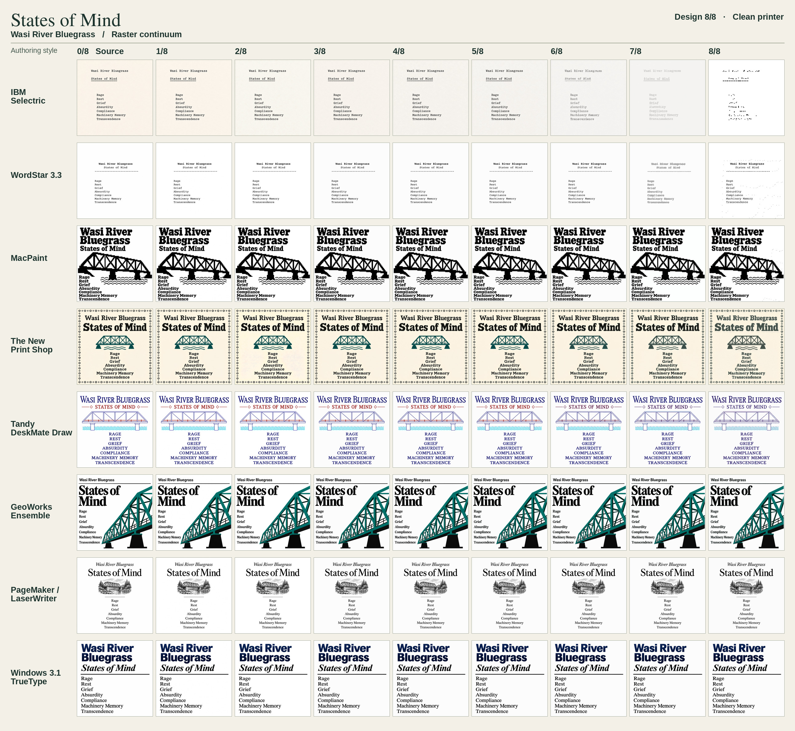
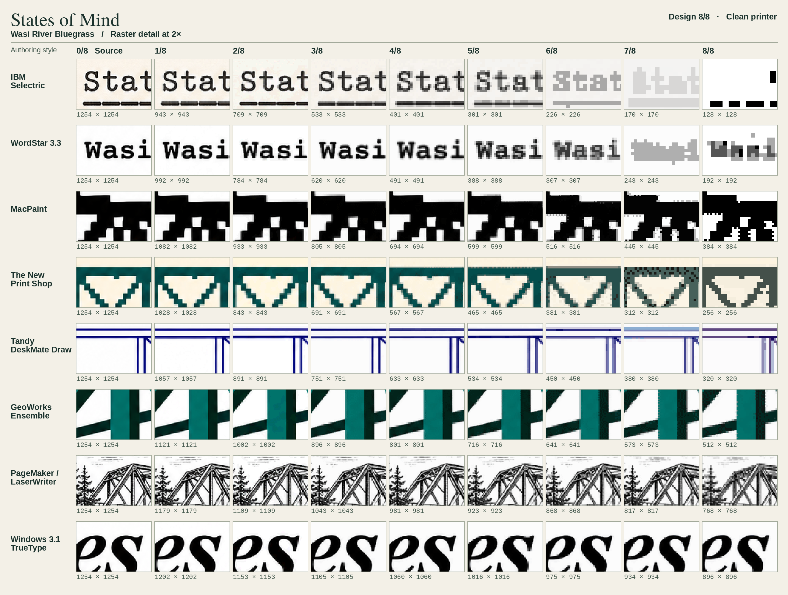

# States of Mind · raster continuum

Each row begins with the published **design 8/8** cover for that style. Read across to see the effect of raster strengths **0–8** on exactly the same lettering and artwork. The printer stays **clean** throughout. [Companion design grid](../grid/)

## See what changes at pixel size

The detail sheet follows one patch of lettering or bridgework across each row. The crops are enlarged 2× with nearest-neighbour sampling. The dimensions below each crop give the working grid for the entire cover. Open the sheet at full size to see individual pixels.

At 8/8 the Selectric’s 128-pixel, two-ink grid drops much of the typewritten title. MacPaint’s heavier bridge silhouette survives its two-ink conversion at 384 pixels. The fine truss and trees in the PageMaker engraving still resolve at 768 pixels and 64 gray levels.

## Open a full-size cover

Select a setting below. To move through a row with the arrow keys, download the repository and open this folder’s `index.html` in a browser. The viewer shows the working grid, palette budget and dithering for each image.

| Style | 0 | 1 | 2 | 3 | 4 | 5 | 6 | 7 | 8 |
| --- | --- | --- | --- | --- | --- | --- | --- | --- | --- |
| IBM Selectric | [0](../eight-styles/selectric.png) | [1](selectric/1.png) | [2](selectric/2.png) | [3](selectric/3.png) | [4](selectric/4.png) | [5](selectric/5.png) | [6](selectric/6.png) | [7](selectric/7.png) | [8](selectric/8.png) |
| WordStar 3.3 | [0](../eight-styles/wordstar.png) | [1](wordstar/1.png) | [2](wordstar/2.png) | [3](wordstar/3.png) | [4](wordstar/4.png) | [5](wordstar/5.png) | [6](wordstar/6.png) | [7](wordstar/7.png) | [8](wordstar/8.png) |
| MacPaint | [0](../eight-styles/macpaint.png) | [1](macpaint/1.png) | [2](macpaint/2.png) | [3](macpaint/3.png) | [4](macpaint/4.png) | [5](macpaint/5.png) | [6](macpaint/6.png) | [7](macpaint/7.png) | [8](macpaint/8.png) |
| The New Print Shop for DOS | [0](../level-8.png) | [1](print-shop/1.png) | [2](print-shop/2.png) | [3](print-shop/3.png) | [4](print-shop/4.png) | [5](print-shop/5.png) | [6](print-shop/6.png) | [7](print-shop/7.png) | [8](print-shop/8.png) |
| Tandy DeskMate Draw | [0](../eight-styles/deskmate.png) | [1](deskmate/1.png) | [2](deskmate/2.png) | [3](deskmate/3.png) | [4](deskmate/4.png) | [5](deskmate/5.png) | [6](deskmate/6.png) | [7](deskmate/7.png) | [8](deskmate/8.png) |
| GeoWorks Ensemble | [0](../eight-styles/geoworks.png) | [1](geoworks/1.png) | [2](geoworks/2.png) | [3](geoworks/3.png) | [4](geoworks/4.png) | [5](geoworks/5.png) | [6](geoworks/6.png) | [7](geoworks/7.png) | [8](geoworks/8.png) |
| PageMaker / LaserWriter PostScript | [0](../eight-styles/pagemaker.png) | [1](pagemaker/1.png) | [2](pagemaker/2.png) | [3](pagemaker/3.png) | [4](pagemaker/4.png) | [5](pagemaker/5.png) | [6](pagemaker/6.png) | [7](pagemaker/7.png) | [8](pagemaker/8.png) |
| Windows 3.1 TrueType | [0](../eight-styles/windows-truetype.png) | [1](windows-truetype/1.png) | [2](windows-truetype/2.png) | [3](windows-truetype/3.png) | [4](windows-truetype/4.png) | [5](windows-truetype/5.png) | [6](windows-truetype/6.png) | [7](windows-truetype/7.png) | [8](windows-truetype/8.png) |

Level 0 opens the published master. Levels 1 and 2 reduce the working grid and retain 128 and 32 steps per colour channel, respectively. Levels 3–8 use progressively smaller grids and palette budgets with each style’s default dithering. Every result is sampled directly from its row’s master and returned to the master’s canvas size. The endpoint grids are artistic presets. [Raster filter guide](../../../../retro-dtp/references/image-filter.md) · [Per-image settings and SHA-256 hashes](frames.json)
