# Skill workflow storyboards

Thirteen six-panel concept illustrations cover the current thirteen-skill inventory at source revision `fb3e9f17255757fa1fdd158f6d0da4d00b98065c`. Refreshed 2026-11-05; later source changes require reconciliation. The original ten-board manifest, prompts, lineage and prior coverage-board image remain in [revision history](revisions/20261022/README.md).

These are AI-generated illustrations, not implemented products. All sample UI data, including file sizes, timing and frame counts, are fictional and are not technical calculations or evidence. Canonical skill sources and their references take precedence. Human acceptance remains pending.

[Local HTML gallery](index.html) · [Source and asset manifest](manifest.json) · [Generation record](generation.json) · [Asset lineage](asset-lineage.json) · [Feature specification](../../specs/001-skill-storyboards/spec.md) · [Work and safety record](../../specs/001-skill-storyboards/work-and-safety.md)

- [AI Operational Governance](#ai-operational-governance)
- [Harnessed Dispatch](#harnessed-dispatch)
- [Project Vault Operator](#project-vault-operator)
- [Gentle Boss · Call and Response](#call-and-response-harness)
- [Creative Seed Development](#creative-seed-development)
- [EGBC AI Professional Practice](#egbc-ai-professional-practice)
- [Engineering Work and Safety](#engineering-work-safety)
- [Forward-Deployed AI Engineer](#forward-deployed-ai-engineer)
- [Image and Card Coverage Harness](#image-card-coverage-harness)
- [PEO Practice Guideline Reference](#peo-guideline)
- [Stickler Prime](#stickler-prime)
- [Build Music Video](#build-music-video)

- [Farmer Jones Victory Garden](#farmer-jones-victory-garden)

## Harnessed Dispatch

[Canonical skill](../../.agents/skills/harnessed-dispatch/SKILL.md) · [Full PNG](assets/harnessed-dispatch.png)

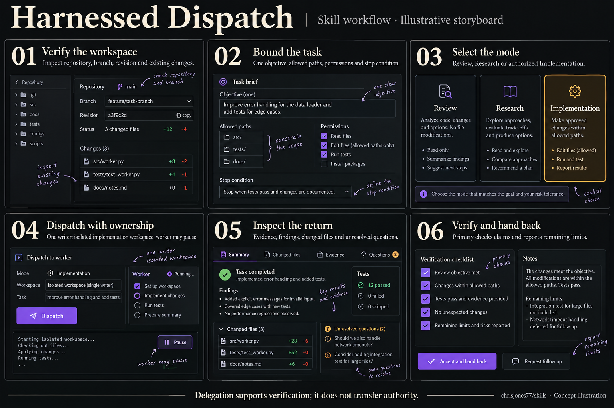

1. Verify the workspace — inspect repository, branch, revision and existing changes.
2. Bound the task — one objective, allowed paths, permissions and stop condition.
3. Select the mode — Review, Research or authorized Implementation.
4. Dispatch with ownership — one writer; isolated implementation workspace; worker may pause.
5. Inspect the return — evidence, findings, changed files and unresolved questions.
6. Verify and hand back — primary checks claims and reports remaining limits.

Delegation supports verification; it does not transfer authority.

Human acceptance: pending.

## Project Vault Operator

[Canonical skill](../../.agents/skills/project-vault-operator/SKILL.md) · [Full PNG](assets/project-vault-operator.png)

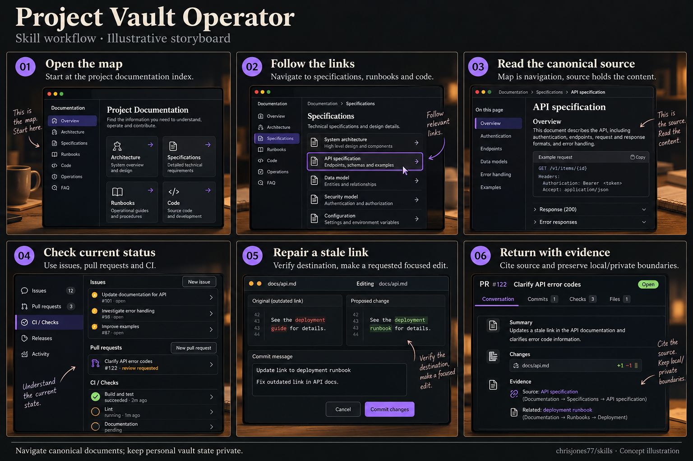

1. Open the map — start at the project documentation index.
2. Follow the links — navigate to specifications, runbooks and code.
3. Read the canonical source — map is navigation, source holds the content.
4. Check current status — use issues, pull requests and CI.
5. Repair a stale link — verify destination, make a requested focused edit.
6. Return with evidence — cite source and preserve local/private boundaries.

Navigate canonical documents; keep personal vault state private.

Human acceptance: pending.

## Gentle Boss · Call and Response

[Canonical skill](../../call-and-response-harness/SKILL.md) · [Full PNG](assets/call-and-response-harness.png)

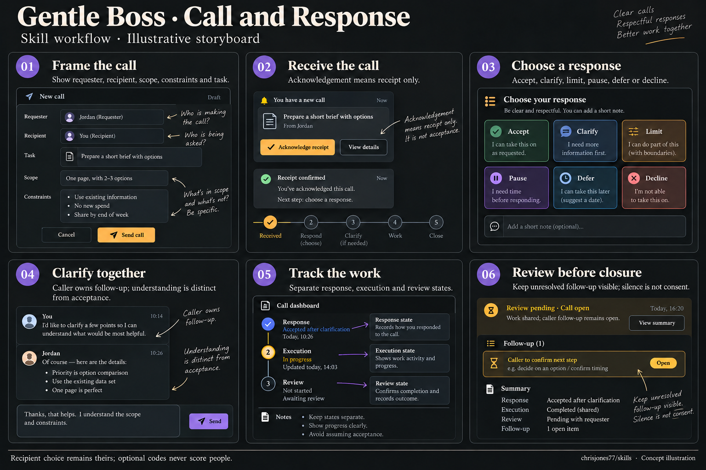

1. Frame the call — show requester, recipient, scope, constraints and task.
2. Receive the call — acknowledgement means receipt only.
3. Choose a response — accept, clarify, limit, pause, defer or decline.
4. Clarify together — caller owns follow-up; understanding is distinct from acceptance.
5. Track the work — separate response, execution and review states.
6. Review before closure — keep the call open while required review or follow-up remains outstanding; silence is not consent.

Recipient choice remains theirs; optional codes never score people.

Human acceptance: pending.

## Creative Seed Development

[Canonical skill](../../creative-seed-development/SKILL.md) · [Full PNG](assets/creative-seed-development.png)

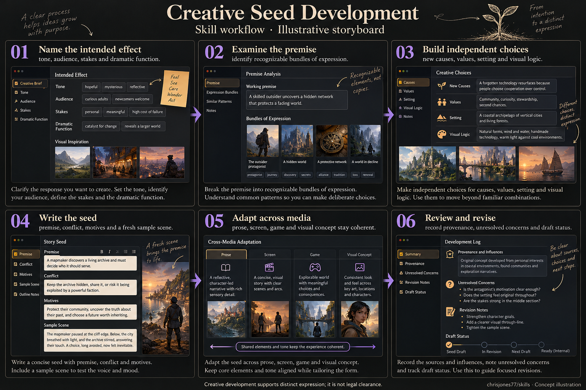

1. Name the intended effect — tone, audience, stakes and dramatic function.
2. Examine the premise — identify recognizable bundles of expression.
3. Build independent choices — new causes, values, setting and visual logic.
4. Write the seed — premise, conflict, motives and a fresh sample scene.
5. Adapt across media — prose, screen, game and visual concept stay coherent.
6. Review and revise — record provenance, unresolved concerns and draft status.

Creative development supports distinct expression; it is not legal clearance.

Human acceptance: pending.

## EGBC AI Professional Practice

[Canonical skill](../../egbc-ai-professional-practice/SKILL.md) · [Full PNG](assets/egbc-ai-professional-practice.png)

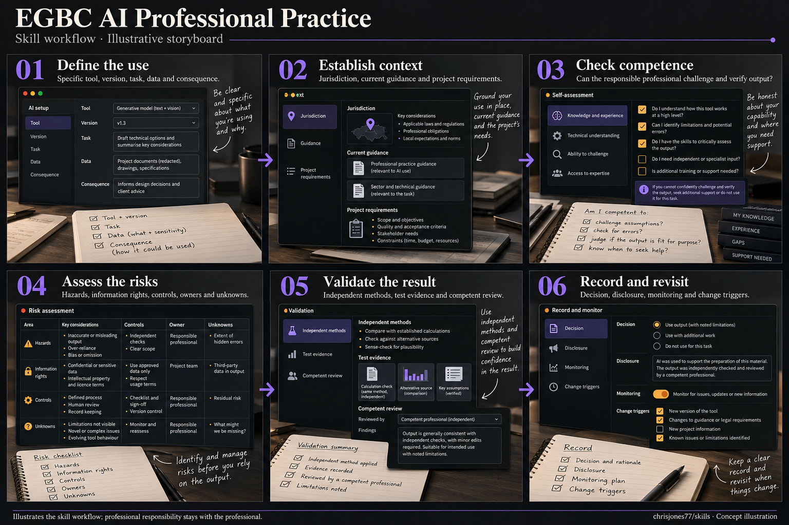

1. Define the use — specific tool, version, task, data and consequence.
2. Establish context — jurisdiction, current guidance and project requirements.
3. Check competence — can the responsible professional challenge and verify output?
4. Assess the risks — hazards, information rights, controls, owners and unknowns.
5. Validate the result — independent methods, test evidence and competent review.
6. Record and revisit — decision, disclosure, monitoring and change triggers.

Illustrates the skill workflow; professional responsibility stays with the professional.

Human acceptance: pending.

## Engineering Work and Safety

[Canonical skill](../../engineering-work-safety/SKILL.md) · [Full PNG](assets/engineering-work-safety.png)

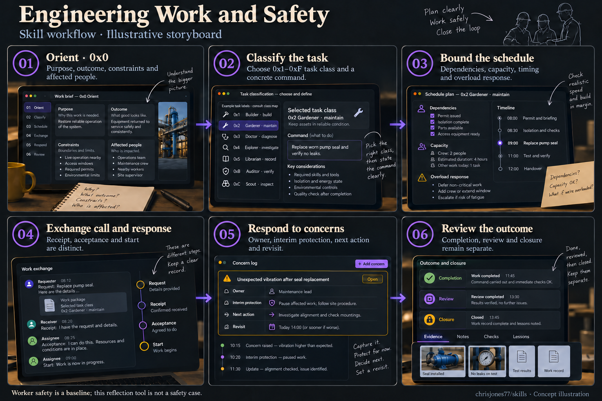

1. Orient · 0x0 — purpose, outcome, constraints and affected people.
2. Classify the task — use the canonical 0x1–0xF class and command map; the maintenance example is 0x2 Gardener / maintain.
3. Bound the schedule — dependencies, capacity, timing and overload response.
4. Exchange call and response — receipt, acceptance and start are distinct.
5. Respond to concerns — owner, interim protection, next action and revisit.
6. Review the outcome — completion, review and closure remain separate.

Worker safety is a baseline; this reflection tool is not a safety case.

Human acceptance: pending.

## Forward-Deployed AI Engineer

[Canonical skill](../../forward-deployed-ai-engineer/SKILL.md) · [Full PNG](assets/forward-deployed-ai-engineer.png)

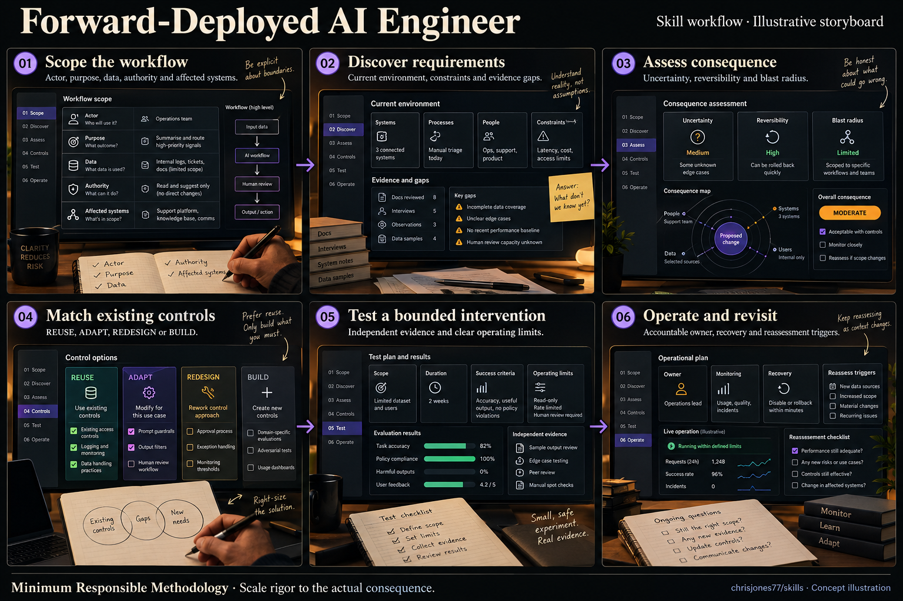

1. Scope the workflow — actor, purpose, data, authority and affected systems.
2. Discover requirements — current environment, constraints and evidence gaps.
3. Assess consequence — uncertainty, reversibility and blast radius.
4. Match existing controls — REUSE, ADAPT, REDESIGN or BUILD.
5. Test a bounded intervention — independent evidence and clear operating limits.
6. Operate and revisit — accountable owner, recovery and reassessment triggers.

Minimum Responsible Methodology · Scale rigor to the actual consequence.

Human acceptance: pending.

## Image and Card Coverage Harness

[Canonical skill](../../image-card-coverage-harness/SKILL.md) · [Full PNG](assets/image-card-coverage-harness.png)

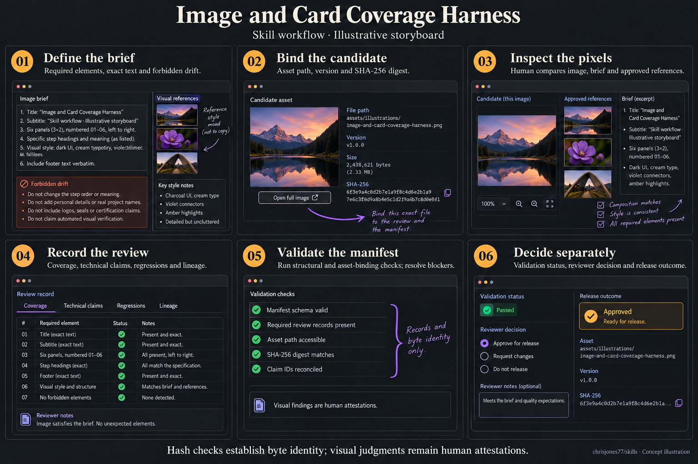

1. Define the brief — required elements, exact text and forbidden drift.
2. Bind the candidate — asset path, version and SHA-256 digest.
3. Inspect the pixels — declared reviewer compares the candidate, brief and references.
4. Record the review — identify reviewer kind; cover geometry, action, text and timing.
5. Validate the manifest — run structural and asset-binding checks; resolve blockers.
6. Decide separately — assistant review stays HOLD until actual human acceptance evidence exists.

Hash checks establish byte identity. Assistant review is not human acceptance.

Human acceptance: pending.

## PEO Practice Guideline Reference

[Canonical skill](../../peo-guideline/skill.md) · [Full PNG](assets/peo-guideline.png)

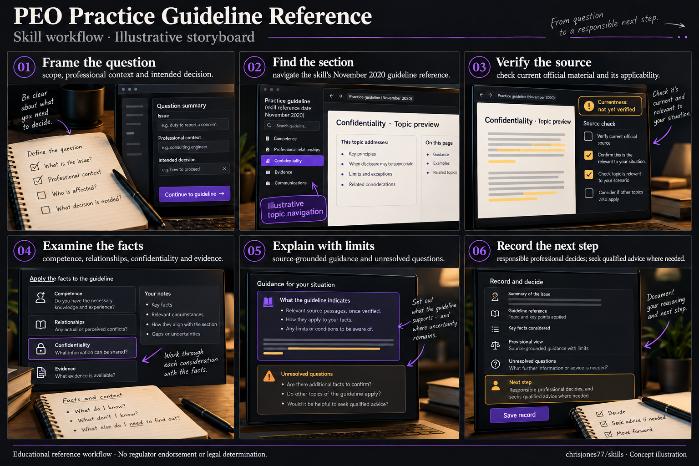

1. Frame the question — scope, professional context and intended decision.
2. Find the section — navigate the skill's November 2020 guideline reference.
3. Verify the source — check current official material and its applicability.
4. Examine the facts — competence, relationships, confidentiality and evidence.
5. Explain with limits — source-grounded guidance and unresolved questions.
6. Record the next step — responsible professional decides; seek qualified advice where needed.

Educational reference workflow · No regulator endorsement or legal determination.

Human acceptance: pending.

## Stickler Prime

[Canonical skill](../../stickler-prime/SKILL.md) · [Full PNG](assets/stickler-prime.png)

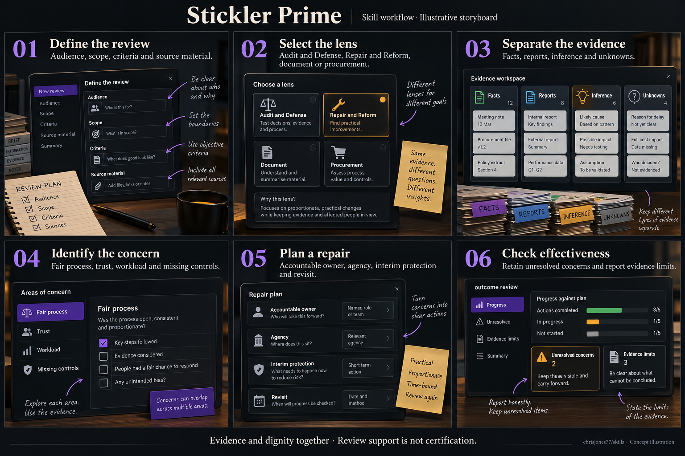

1. Define the review — audience, scope, criteria and source material.
2. Select the lens — Audit and Defense, Repair and Reform, document or procurement.
3. Separate the evidence — facts, reports, inference and unknowns.
4. Identify the concern — fair process, trust, workload and missing controls.
5. Plan a repair — accountable owner, agency, interim protection and revisit.
6. Check effectiveness — retain unresolved concerns and report evidence limits.

Evidence and dignity together · Review support is not certification.

Human acceptance: pending.

## Build Music Video

[Canonical skill](../../build-music-video/SKILL.md) · [Full PNG](assets/build-music-video.png)

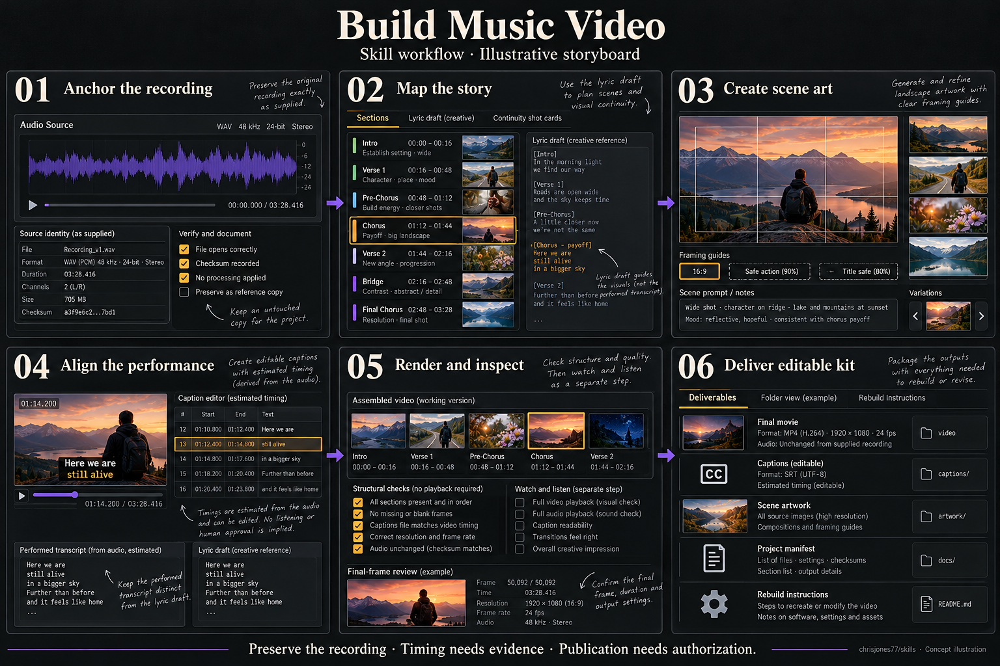

1. Anchor the recording — retain supplied soundtrack identity, sources and corrections.
2. Map the story — connect sections, lyric payoffs and continuity before choosing shots.
3. Create scene art — use the output geometry and inspect subjects, action and safe areas.
4. Align the performance — separate lyric draft, performed transcript and editable captions; label estimated timing.
5. Render and inspect — distinguish structural checks from watching, listening and final-frame review.
6. Deliver editable kit — retain movie, captions, artwork, manifest and rebuild instructions.

Preserve the recording · Timing needs evidence · Publication needs authorization. Sample durations, file sizes and frame counts in the image are fictional and must not be used as calculations.

Human acceptance: pending.

## Farmer Jones Victory Garden

[Canonical skill](../../farmer-jones-victory-garden/SKILL.md) · [Full PNG](assets/farmer-jones-victory-garden.png)

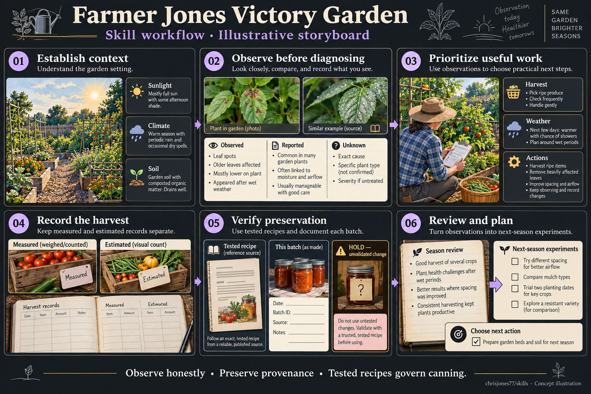

1. Establish context — climate, season, sunlight, soil, labour and equipment.
2. Observe before diagnosing — separate observed, measured, reported, inferred and unknown.
3. Prioritize useful work — distinguish urgent, beneficial and optional actions.
4. Record the harvest — keep measurements and estimates separate, with source and method.
5. Verify preservation — use an exact authoritative tested recipe; hold unsupported changes.
6. Review and plan — turn season evidence into bounded next-season experiments.

Observe honestly · Preserve provenance · Tested recipes govern canning. Illustration is not field inspection, recipe validation or safety certification.

Human acceptance: pending.

## AI Operational Governance

[Canonical skill](../../ai-operational-governance/SKILL.md) · [Full PNG](assets/ai-operational-governance.png)

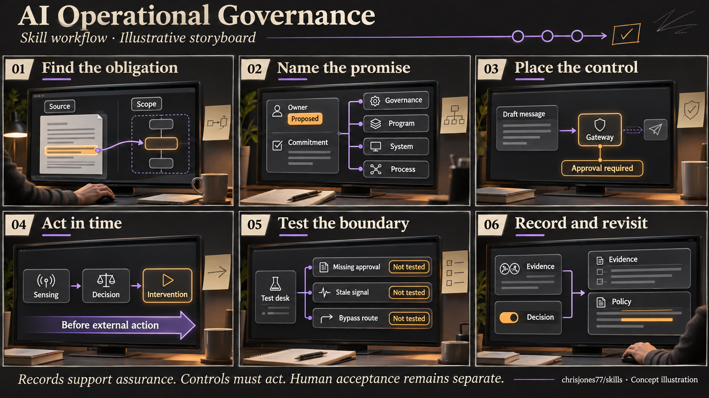

1. Find the obligation — locate the applicable source and workflow boundary.
2. Name the promise — connect an observable commitment to proposed ownership and operating responsibilities.
3. Place the control — enforce required approval before a message is sent.
4. Act in time — connect sensing, decision and intervention before the external action.
5. Test the boundary — examine missing approval, stale signals and bypass paths; illustration outcomes are not tested.
6. Record and revisit — preserve evidence separately from decisions and reconsider changed policy.

Records support assurance. Controls must act. Human acceptance remains separate. This is a concept illustration, not an implemented QVCH/UWH adapter or proof of control effectiveness.

Human acceptance: pending.
