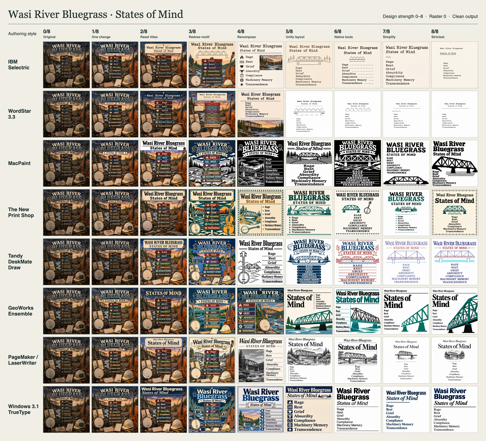

# Retro-DTP

Redesign an image as if its maker had a typewriter, a bitmap paint program or an early page-layout system. Retro-DTP can also compose editable flyers, cards, banners, newsletters and office documents.

## Try it in ChatGPT Images

Save the design card and attach it in ChatGPT with your image. For a new design, attach the card and describe what you want to make. [Get the design card](https://raw.githubusercontent.com/chrisjones77/skills/main/docs/retro-dtp/retro-design-filter.txt)

> Make this look like The New Print Shop for DOS. Keep the wording.

The card starts at design 4/8, raster 0 and clean output. To try a stronger redesign, say “Push the design to 8/8.” To change the print finish, say “Add nine-pin colour.”

## Install in Codex

Paste this into a Codex chat once:

```text
$skill-installer Install https://github.com/chrisjones77/skills/tree/main/retro-dtp
```

Then attach your image and ask:

> $retro-dtp Make this a DeskMate Draw poster. Keep the wording.

## States of Mind design grid

[](https://github.com/chrisjones77/skills/tree/main/docs/retro-dtp/states-of-mind/grid/)

Read across each row from design 0/8 to 8/8. Read down a column to compare all eight toolsets at the same strength. Raster stays at 0 and the printer stays clean. [Browse the full grid](https://github.com/chrisjones77/skills/tree/main/docs/retro-dtp/states-of-mind/grid) · [Compare the nine raster strengths at design 8/8](https://github.com/chrisjones77/skills/tree/main/docs/retro-dtp/states-of-mind/raster-grid) · [Compare four printer finishes](https://github.com/chrisjones77/skills/tree/main/docs/retro-dtp/states-of-mind/printer-grid)

## Choose the settings

| Choice | What it controls |
| --- | --- |
| Style | Pick IBM Selectric, WordStar 3.3, MacPaint, The New Print Shop for DOS, Tandy DeskMate Draw, GeoWorks Ensemble, PageMaker / LaserWriter PostScript or Windows 3.1 TrueType. |
| Design strength, 0–8 | At 0 the original is used. At 1 one placement or lettering decision changes. At 4 the page is recomposed. At 8 every element must be explainable by the chosen toolset. |
| Raster strength, 0–8 | Applies pixel-grid, palette and optional dithering changes to the finished composition. Choose 0 to see the design at full detail. |
| Printer appearance | Clean output is the default for a redesign. Request a simulated finish, such as nine-pin colour, after composing the page. |

When trying a different setting, reuse the original reference and required words. The default style is The New Print Shop for DOS.

## Share with a ChatGPT workspace

If your workspace supports skills, upload Retro-DTP once and share its install link with teammates. They can then use it in new chats. [OpenAI’s workspace skill-sharing guide](https://help.openai.com/en/articles/20001066-skills-in-chatgpt)

## Use as a standalone skill

Copy this entire `retro-dtp/` directory into your host’s skills directory. Keep its fonts, artwork, templates, scripts and references together. In Codex, invoke `$retro-dtp` with your brief. The agent instructions and supported print formats are in the [skill entry point](SKILL.md).

For the local CLI, use Node.js 24. From this directory run:

```sh
npm ci
node scripts/retro-dtp.mjs design-card --out retro-design-filter.txt
```

To generate instructions for one specific composition, put your required wording in a UTF-8 file named `subject.txt`:

```sh
node scripts/retro-dtp.mjs design --mode deskmate --strength 4 --brief subject.txt --out prompt.txt
```

Give the resulting prompt and original reference to the image generator. Choose fresh output names for revisions.

## Produce a print document

Install Poppler, then install the Chromium build selected by the package. Run these commands from the skill directory:

```sh
node node_modules/playwright/cli.js install chromium
node scripts/retro-dtp.mjs doctor --json
node scripts/retro-dtp.mjs modes --json
```

Use the sample JSON brief and the `prepare`, `render` and `verify` commands in the production guide. A print job includes editable source, a PDF and previews rendered from that PDF. Inspect the copy, margins and page order before marking a revision complete. [Production guide](references/production.md) · [Editing a revision](references/editing.md)

The optional raster helper runs with Python 3.9+ and Pillow 9.2+. It can export a PNG or an offline raster dial. The presets are period-inspired interpretations using redistributable assets. [Raster guide](references/image-filter.md) · [Historical sources](references/historical-sources.md)
