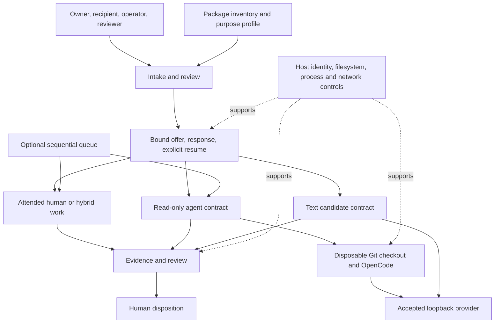

# Unified Work Harness — engineered system description

Revision 1 · 7 November 2026

Status: descriptive baseline for review. This document describes the installed package and its stated operating constraints. It is not a certification, a deployment authorization, or a completed independent assurance assessment.

## 1. Purpose and intended use

The Unified Work Harness (UWH) is a software-supported work coordination system. It translates an intended outcome into a bounded assignment, records review and recipient responses, gates supported execution paths, and preserves evidence for a separate decision about the result.

Its system-level purpose is to keep the relationship between **requested work, permitted effects, performed work, and accepted results** explicit and inspectable. It combines procedural methods with executable validation, state management, provider interfaces, and local evidence retention.

Intended users are assignment owners, operators, human or hybrid recipients, agent recipients, and reviewers. Affected parties also include people whose information enters an assignment and people who may rely on its output. Consequence depends on the assignment: a document review and an operational decision require different evidence and oversight.

This documentation task uses purpose **0x5 record**, with **0x8 represent** and **0xB verify** as companion lenses. These labels organize the work; they grant no authority.

## 2. Configuration baseline and evidence status

Baseline: the `unified-work-harness/` package at repository commit `b4c61f8a29b306df47205429129673ca9a246250`. The installed package and this repository baseline returned the same inventory digest before this documentation was added.

The package inventory command completed successfully against the pre-documentation baseline and reported:

| Identity | Observed value |
| --- | --- |
| Inventory schema | `unified.package-inventory.v1` |
| Package SHA-256 | `569bdf01ee3f36c20946e485d8c45a7a05d0e27e94ac776701153379cf860c86` |
| Embedded bundle SHA-256 | `3f13a73e97861ea232b0b82edf9836a802a6795dd930f2c9a4514b6e61decb7a` |
| Inventory authority result | `execution_authorized: false` |

The package digest identifies the inventory's manifest-selected file identities. It does not attest the running process, independently establish provenance, authenticate a person, or bind external binaries and models. The observed digest identifies the pre-documentation baseline, not a newly approved execution pin. Adding this document to the package manifest and linking it from the package guide changes the package digest. Obtain the current digest with `node package.mjs inventory`; do not use the historical digest above for a revised package.

Evidence classes used here:

- **Observed:** successful inventory; installed guidance read; selected implementation functions and test declarations inspected.
- **Specified:** behavior described by the installed operating guides, particularly detailed worker isolation and recovery constraints.
- **Unverified in this task:** full regression results, live model behavior, host isolation, user identity, actual deployment authority, and production fitness.

No provider was invoked, contract accepted, queue dispatched, or source change candidate applied for this documentation. The original descriptive review did not run the regression suite. Test references below identify available verification assets; validation of this documentation change is reported separately in its pull request.

## 3. System boundary

The software boundary includes the installed guidance, package resolver, intake reviewer, work-contract machinery, attended lifecycle, execution adapters, queue supervisor, candidate preparation, and evidence formats.

The operational system additionally requires people and host services. These dependencies are essential to the claims the software can support.

The diagram is a functional view, not a deployment topology. The documented queue supports attended work and accepted v5/v6 read-only envelopes. It does not establish queue support for the separate text-candidate API.

External dependencies include a trusted POSIX host and filesystem; Node.js 22.13 or later for the complete package and built-in SQLite queue; Git; OpenCode for supported read-only contracts; the chosen provider/model; and host mechanisms for authenticating people, delivering messages, and enforcing isolation. Guidance can be read without these execution services.

## 4. Architecture and interfaces

| Subsystem | Principal interface | Responsibility and output | Boundary |
| --- | --- | --- | --- |
| Purpose and capability resolution | `packageInventory`, `resolvePackageProfile` in `package.mjs` | Inventory file identities; resolve fixed capability dependencies and effects; return hold or resolved-for-review | Resolution never authorizes execution; no arbitrary external skill loading |
| Preliminary and reviewed intake | `inspectWorkIntake` in bundle; `reviewIntake`, `verifyIntakeForOffer` in `intake.mjs` | Check completeness; bind exact compact intake and attributed assessment; check capacity declarations, roles and expiry | Semantic conflicts, truthful declarations, actual capacity and authority require human evidence |
| Attended coordination | `offerCoordination`, `respond`, `reoffer`, `handoff` in `coordination.mjs` | Record offers, responses, concerns, revisions, submission and review | Caller preserves authoritative record and verifies actual responses; attended scopes are not provider contracts |
| Read-only integration | `buildPackageScope` in `integrated.mjs`; `contractRoundtrip` in `bundle.mjs` | Bind package/profile/intake review to a v6 contract; inspect a pinned source through a supervised worker | Supported contract worker is OpenCode; read events detect scope violations after access |
| Sequential supervision | `createQueue`, `dispatchNext`, `respondAttended`, `reviewCandidate`, `stopQueue` in `queue.mjs` | FIFO admission, durable reservations, budgets, pending review and interruption handling | Operator selects work; queue does not invent assignments or deliver messages to people |
| Candidate preparation | `buildCandidateScope`, `candidateRoundtrip`, `readCandidateForReview` in `candidate.mjs` | Produce private UTF-8 replacement proposals or literal-text defect fixtures | No source application, generated-code execution, commit, merge or deployment |
| Methods and reviewer aids | `methods.md`, native reviewer templates | Structure coverage, advisory work, fair process and pre-offer critique | Guidance and advisory findings do not establish human acceptance |

The embedded bundle also exposes lower-level interfaces. Their existence does not make every worker or adapter a supported high-level contract route. In particular, the installed crosswalk distinguishes lower-level Codex/Aider interfaces from the supported OpenCode read-only contract.

## 5. Work lifecycle and ownership

The common lifecycle is: orient → inspect sources and effects → review intake → offer exact scope → obtain recipient response → explicitly resume → perform bounded work → submit evidence → review → record disposition.

This is a conceptual sequence. Individual APIs implement different state machines and must retain their own schema and transition rules.

| Role | Operational responsibility |
| --- | --- |
| Assignment owner / accountable human | Establish intended use and actual authority; resolve scope and concerns; own decisions about further work |
| Operator | Maintain authoritative records, inspect dependencies, prepare storage and isolation, dispatch only the accepted revision, reconcile interruption |
| Recipient | Respond to the offered scope; clarify, decline, defer or accept; explicitly resume; report evidence and limits |
| Reviewer | Review actual evidence against criteria; record rework, acceptance or rejection within their authority |
| Host/provider operator | Establish identity, model locality, environment controls and service behavior outside the package |

A named role is a declaration. Matching that label in an API is not authentication. Human capacity and consent must be obtained from people, not inferred from an agent response.

Attended work permits clarification, pause, rework and handoff. A changed assignment requires a new offer and acceptance. Handoff preserves the predecessor and creates an unaccepted successor; unresolved concerns cannot be erased by changing the recipient. Approval and closure are distinct actions in the attended interface.

For provider work, successful execution returns evidence with review pending. The read-only runtime does not close the original contract. Queue advancement requires a separate attributed review decision for the matching result. Applying a candidate requires separate authority.

## 6. Contract and data model

An assignment connects outcome, people, allowed/prohibited effects, workspace identity, purpose, acceptance criteria, limits and evidence. Hashes bind exact representations; changing bound bytes requires renewed review rather than substituting a new digest into an old acceptance.

| Contract generation | Added binding or control |
| --- | --- |
| Read-only v1 | Separate assignment byte identity; original CLI compatibility path |
| Read-only v2 | Draft inputs and exact endpoint |
| Read-only v3 | Optional private result destination and owner-managed retention |
| Read-only v4 | Single-attempt invocation ledger |
| Read-only v5 | Execution start window, with ledger required |
| Read-only v6 | Full-package profile and exact reviewed intake, including review expiry; retains required ledger and window |
| Attended scope v2 | Declared workspace binding and revision history; actual workspace not inspected by this binding |
| Text candidate v2 | Candidate request, runtime/package identities, scope, budgets, provider, review, private result and ledger |

These versions belong to separate interface families. Attended v2 and text-candidate v2 are not read-only v2. Older read-only contracts retain their original checks; they do not acquire v6 controls automatically.

Private records may contain sensitive outcomes, names, paths, concerns and evidence references. Hashes and metadata can also be sensitive. Results, ledgers and queue storage belong in approved private locations outside source checkouts. Provider queue records retain identity/state metadata; attended queue records retain the complete attended history. Owners manage retention and reconciliation.

## 7. Functional requirements and verification trace

The following requirements are extracted from the installed design. They are useful review criteria, not newly imposed operating authorization.

| ID | Required behavior | Implementation / available evidence |
| --- | --- | --- |
| R1 | Hold on changed package identity, unavailable capability, or insufficient/prohibited effects | `package.mjs`; `package-profile.test.mjs` |
| R2 | Bind intake to a distinct reviewer, consistent parties/outcome, adequate declared capacity and current expiry | `intake.mjs`; `intake.test.mjs` |
| R3 | Preserve recipient choice, explicit resume, clarification and superseded history | `coordination.mjs`; `coordination.test.mjs` |
| R4 | Bind v6 work to the reviewed package and intake before execution | `integrated.mjs`, `bundle.mjs`; `integrated.test.mjs` |
| R5 | Limit read-only access to accepted source; reject prohibited workspace/configuration and final checkout changes | `integrated.md`, `bundle.mjs`; `integrated.test.mjs`, `roundtrip.test.mjs` |
| R6 | Consume a single attempt once claimed; reject replay and require reconciliation after uncertainty | Ledger interfaces in bundle; candidate and queue recovery tests |
| R7 | Enforce accepted endpoint, start window and relevant resource limits | Integrated/candidate/queue interfaces and corresponding tests |
| R8 | Keep sequential work gated by review; stop later work on rejection or unresolved interruption | `queue.mjs`; `queue.test.mjs` |
| R9 | Retain proposed edits privately, validate approved paths and literal assertions, and preserve source | `candidate.mjs`; `candidate.test.mjs` |
| R10 | Keep automated evidence separate from substantive acceptance | Pending-review receipts; attended review transitions; queue review interface |

Selected implementation inspection directly confirmed R1/R2 profile and intake checks, v6 policy binding, candidate claim/result handling, and queue review/reconciliation gates. Other detailed behaviors above are documented claims with named test assets; exhaustive implementation verification remains outside this description.

## 8. Failure modes, controls and residual exposure

This is a qualitative engineering analysis. No failure probabilities, quantitative risk rankings or safety integrity level have been established.

| Failure mode | Existing control | Residual exposure / responsible response |
| --- | --- | --- |
| Different source or assignment executes | Package, request, workspace and scope digests; rechecks | Trusted runtime and immutable source handling still needed; hashes are not provenance or loaded-code attestation |
| Forged authority or acceptance | Matching named roles, distinct reviewer and bound response records | Host must authenticate actors and verify their authority; same-user record tampering remains possible |
| Private data reaches an unintended processor | Declared data restrictions, scoped reads, loopback endpoints and redirect rejection | Loopback does not prove local inference; verify provider deployment and host network policy |
| Repository content redirects the worker | Documented configuration isolation and rejection of unoffered nested instructions | Prompt injection is not eliminated; inspect content and minimize scope |
| Worker reads or changes unauthorized material | Scoped configuration, event inspection, disposable checkout and final snapshots | Detection after a read cannot undo disclosure; final-state comparison cannot exclude transient writes; host sandbox required |
| Duplicate or uncertain attempt after crash | Durable claim, terminal ledger and queue reconciliation | Deletion, rollback, restored copies and same-user interference can defeat local history; never clear state simply to retry |
| Stop arrives during execution | Queue stop/deadline checks, process-group termination, request cancellation | Delivered requests and detached descendants may continue; host/provider intervention may be required |
| Incorrect result appears valid | Shape/path checks, literal assertions, hashes and separate review | A well-formed answer or matching hash can still be wrong; reviewer evaluates substance and intended use |
| Review is unavailable or overloaded | Intake capacity/availability checks and review-gated progression | Declarations can become stale; owner must reassess real human capacity |
| Partial persistence or cleanup failure | Ledger/result identity checks; interrupted work held for reconciliation | Orphaned artifacts or scratch data may remain; preserve evidence and apply retention policy |
| Stale provider lease blocks progress | Owner/token checks and guarded stale-lease recovery | Ambiguous state requires operator inspection; crash during recovery can leave a guard |

## 9. Operating envelope and assurance limits

The supported execution envelope assumes trusted binaries, a trustworthy local clock and filesystem, intact private records, controlled concurrency, verified provider locality, and external enforcement of filesystem/network/process boundaries.

Read-only means source preservation within the documented contract. Execution still creates temporary files, invokes processes, writes ledger/evidence state and communicates with a provider. It therefore has effects beyond reading.

The harness supplies consistency checks and bounded control mechanisms. It does not supply an OS security boundary, authenticated consent, professional competence, model truthfulness, legal compliance, or an independent acceptance decision. Its name “Hypervisor” identifies work-contract machinery; it does not establish hardware virtualization or kernel isolation.

Synthetic tests can demonstrate specified responses to controlled fixtures. They cannot establish all live model/server compatibility, confidentiality, professional suitability or production readiness. A live smoke check also remains limited to the tested configuration and scenario.

## 10. Maintenance, release and reassessment

Maintain a reviewed baseline of package bytes, external runtime versions, model/provider configuration and host controls. A package change invalidates the previous package pin; it requires inspection and a newly reviewed offer for dependent work. Do not silently upgrade accepted records.

Before relying on a deployment, the operator should record the actual runtime identities, run the relevant deterministic tests in an authorized environment, assess intended-use consequences, exercise interruption/recovery, and arrange substantive result review. A live provider test is a separately scoped activity.

Reassess when the package, worker, provider/model, endpoint, operating system, storage, data class, intended use, scope, reviewer availability or authority changes. Preserve concerns and prior dispositions through rework and handoff.

Open assurance items for this baseline are: current full-suite results; independently verified host controls and provider locality; authenticated lifecycle integration; live configuration compatibility; and a named human's acceptance of this description for its intended use. None prevents maintaining this descriptive document; each limits stronger operational claims.

## 11. Source register

All sources below are package files read or selectively inspected for this document. Historical links inside `sources.md` were not independently retrieved.

- [Skill entry point](SKILL.md), [package guide](package-guide.md), [capability crosswalk](capabilities.md).
- [Worked methods](methods.md), [source lineage](sources.md).
- [Intake](intake.md), [attended coordination](coordination.md), [v6 integration](integrated.md), [queue](queue.md), [candidates](candidate.md).
- Implementation inspection: [package resolver](package.mjs), [intake checks](intake.mjs), [v6 binding](integrated.mjs), [candidate execution](candidate.mjs), [queue reconciliation and review](queue.mjs).

Documentation ownership: prepared by the assistant at the user's request; human review and acceptance are unrecorded. This file is distributed with the package and included in its manifest. Its historical baseline identifies the package before this documentation change.
